 

**I build Android apps that do one job well, from the app and its backend to the store listing.**

6 apps on Google Play · 1,300+ downloads · Bulgarian and English

[**Portfolio site: izstudio.web.app**](https://izstudio.web.app)

Every app has its own look, taken from the product itself. Source code is private; each page shows the product, the screens and how it is built.

<table>
<tr>
<td width="50%" align="center" valign="top">

 <b>ISA</b> Grocery prices from six chains, side by side
</td>
<td width="50%" align="center" valign="top">

 <b>CryptoDept Terminal</b> A multi-agent crypto intelligence terminal
</td>
</tr><tr>
<td width="50%" align="center" valign="top">

 <b>Tarot of the Day</b> A daily reading in 13 languages
</td>
<td width="50%" align="center" valign="top">

 <b>SONIRRA</b> A sleep-sounds mixer with timer
</td>
</tr><tr>
<td width="50%" align="center" valign="top">

 <b>CleanX MAX</b> A phone cleaner turned into a game
</td>
<td width="50%" align="center" valign="top">

 <b>BG Toll Speed</b> Average-speed section control for drivers
</td>
</tr><tr>
<td width="50%" align="center" valign="top">

 <b>IZ Studio</b> The bilingual portfolio site for all of the above
</td>
<td width="50%" align="center" valign="top">

 <b>Nefera's Fortune</b> An Egyptian slot game for the browser (in development)
</td></tr><tr>
<td width="50%" align="center" valign="top">

 <b>Vidin Fund "Chitalishta"</b> A bilingual website with a CMS the team edits
</td>
<td></td></tr></table>

| | |
|---|---|
| **Android** | Kotlin, Jetpack Compose, Hilt, Room, Media3, WorkManager, Play Billing, AdMob |
| **Backend** | Firebase (Firestore, Auth, Cloud Functions in TypeScript), Python data pipelines |
| **Web** | Astro, Tailwind, static sites on Firebase Hosting with strict security headers |
| **Quality** | Written audits, lint and unit-test gates, security-rule tests, secrets kept out of repositories |

Also in progress: [thornvael](https://github.com/ivaylozhivkov88/thornvael), a dark-fantasy real-time squad RPG for the browser.

[**izstudio.web.app**](https://izstudio.web.app)

