 

**I build Android apps that do one job well, from the app and its backend to the store listing.**

6 apps on Google Play · 1,300+ downloads · Bulgarian and English

[**Portfolio site: izstudio.web.app**](https://izstudio.web.app)

Every app has its own look, taken from the product itself. Source code is private; each page shows the product, the screens and how it is built.

 

 

 

 

Also in progress: [thornvael](https://github.com/ivaylozhivkov88/thornvael), a dark-fantasy real-time squad RPG for the browser.

[**izstudio.web.app**](https://izstudio.web.app)

